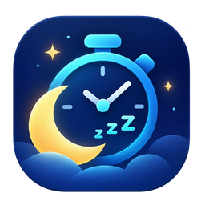
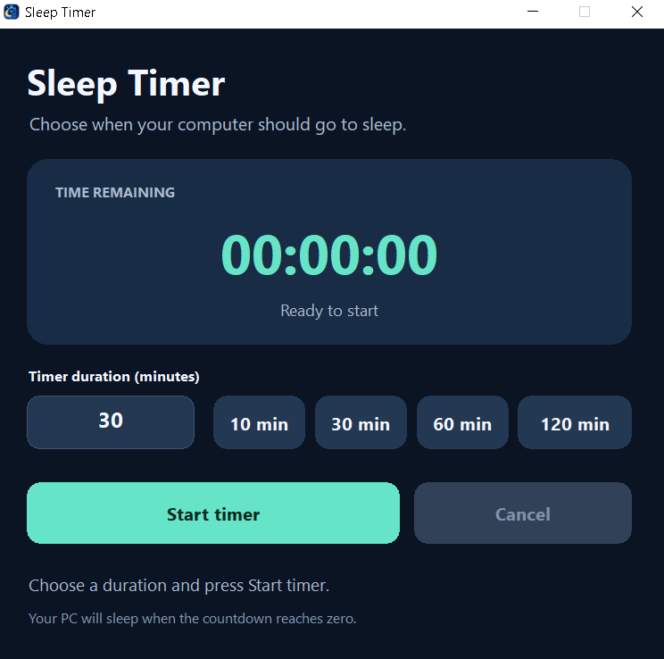

# Sleep Timer for Windows



**Set a timer. Let your PC sleep. That's it.**

A small, free Windows desktop application that does one thing: sends your PC to sleep when a countdown finishes. No accounts, ads, installation wizard, or extra shutdown modes.



*Screenshot: Windows 10, taken from an earlier UI build. The v1.0.1 fix changes countdown painting, not the layout.*

## Features

- Simple dark interface in English
- Presets for 10, 30, 60, and 120 minutes
- Custom duration from 1 to 1440 minutes
- Large countdown with Start and Cancel controls
- Closes without leaving a background timer
- A self-contained Windows x64 EXE with its own application icon

## Download and use

1. Open this repository's **Releases** section.
2. Download `SleepTimer_v1.0.1.exe` from the v1.0.1 release assets.
3. Run the EXE. No installation or Go/Python runtime is required.
4. Select a duration and click **Start timer**. Click **Cancel** to stop the countdown.

**Important:** Keep the application open while the timer is running. Closing the window cancels the active timer. Save your work first: when the countdown reaches zero, Windows receives a system sleep command.

The EXE is **unsigned**, so Windows SmartScreen may show an unknown-publisher warning. You can verify the SHA-256 hash using the checksum file provided with the release. Do not disable antivirus protections to run it.

## Compatibility and evidence

| Item | Status |
| --- | --- |
| Windows 10 | Tested by the project owner; sleep timer working |
| v1.0.1 countdown flicker fix | Verified on Windows 10; no flickering reported |
| Windows 11 | Not yet tested |
| Architectures | x64 (64-bit) build provided |

The executable was verified as a Windows x64 GUI PE file. The four automated timer logic tests passed, and the source was cross-compiled successfully. These checks are not a substitute for a live Windows UI test.

## What happens at zero?

The application preserves the same sleep command as the original batch script:

```cmd
rundll32.exe powrprof.dll,SetSuspendState Sleep
```

Depending on your Windows power configuration, this may hibernate your PC rather than put it into standard sleep. After the command is sent, Cancel cannot reverse the action. The program does not request administrator privileges or send network requests.

## Build from source

Requirements: Windows x64, Go 1.23 or later, and Python 3 available on `PATH`.

```bat
build_windows.bat
```

The script runs the tests, compiles the Win32 GUI application, and embeds `SleepTimer.ico` in `SleepTimer_v1.0.1.exe`. Python is used only while building, and the icon embed script uses only the Python standard library. There are no third-party Go modules.

Run tests manually:

```sh
go test ./...
```

To cross-compile the code without embedding an icon from another OS:

```sh
GOOS=windows GOARCH=amd64 CGO_ENABLED=0 go build -ldflags="-s -w -H=windowsgui" -o SleepTimer_without_icon.exe .
```

The GitHub Actions workflow checks the code and builds the full icon-enabled EXE on a hosted Windows runner. That CI environment does not establish real-world Windows 10 compatibility.

## Changelog and license

See [CHANGELOG.md](CHANGELOG.md) for version notes. The source code is provided under the [MIT License](LICENSE). The included application icon was created with AI assistance. See [NOTICE.md](NOTICE.md) for the attribution note. A historical `legacy/original_sleep-timer.bat` is retained for reference and is not used by the modern application.

Contributions and reports of repeatable issues are welcome. Include the Windows version, timer duration, observed result, and expected result when opening an issue.
